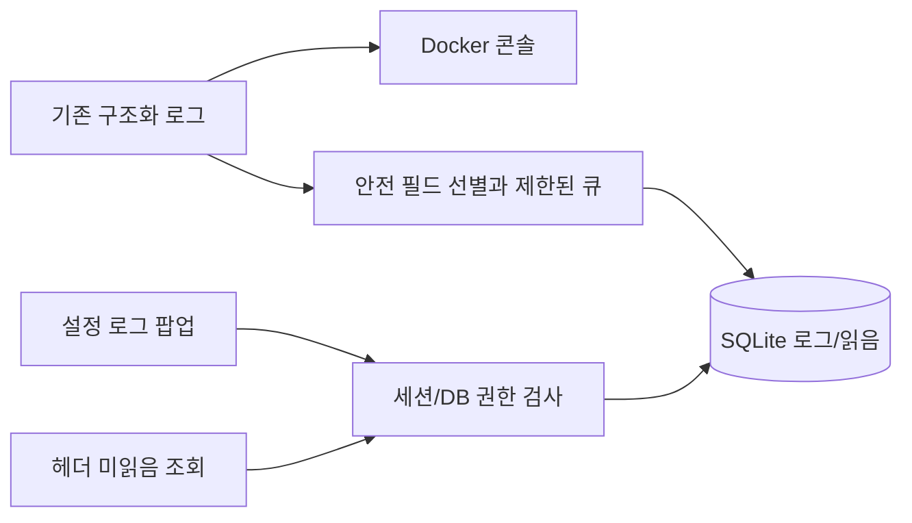

# 설정 로그 팝업과 미읽음 알림 기획

작성일: 2026-10-07. 상태: 검토용 기획안. 구현 전 이 문서와 구현 계획의 정책을 확인한다.

## 목적과 요구사항

Docker 콘솔을 열지 않아도 사용자 본인의 Notion·AI·업무 저장 처리 결과를 확인하고, 관리자는 본인 로그에 더해 서버 공통 오류를 확인한다. 문제가 발생했을 때 상단 설정 아이콘의 미읽음 표시로 발견하고 설정의 로그 팝업에서 원인을 좁힐 수 있어야 한다.

사용자가 요청한 기능:

- 설정에서 로그 팝업을 연다.
- 관리자는 사이트 전체 오류 로그도 확인한다.
- 미읽음 로그가 있으면 상단 설정 아이콘에 알림을 표시한다.
- 성공·경고·오류를 조회하고 **경고·오류만 미읽음 알림에 포함한다**. 이 정책은 사용자 답변으로 확정했다.

사용자 답변으로 추가 확정한 정책: 상세 열람 시 해당 항목만 읽음 처리하고 `모두 읽음`을 별도 제공한다. 관리자 사이트 범위에는 **사용자 없는 서버 공통 오류만** 포함한다. 다른 사용자의 오류는 관리자에게도 노출하지 않는다. 이하 보관기간/갱신 주기 등 수치는 구현 가능한 기본값을 제안한 것이다.

## 현재 프로젝트와 연결점

- `packages/db/src/operation-log.ts`가 JSON 콘솔 로그와 AsyncLocalStorage 기반 `operationId` 상관관계를 제공한다. 현재 범용 로그는 DB에 저장되지 않는다.
- `NotionSyncRun`, Webhook 최근 오류는 개별 기능의 상태 기록이다. 이를 범용 로그나 읽음 상태로 전용하지 않는다.
- 공통 설정은 `apps/web/src/app/(app)/app-settings-button.tsx`, 헤더는 같은 디렉터리의 `layout.tsx`에 있다. 모든 앱 페이지에 적용된다.
- 데스크톱/모바일 설정 버튼이 각각 렌더링된다. 모바일 설정은 `mobile-app-menu.tsx`의 드로어 안에 있다.
- 권한은 signed cookie의 role만으로 판단하지 않고 실제 `User.role`을 DB에서 다시 확인하는 기존 방식을 따른다.
- SQLite runtime bootstrap/raw SQL, 기존 Node/React API를 사용한다. 새 의존성이나 별도 로그 서버를 추가하지 않는다.

## 접근 방식 비교

| 방식 | 이점 | 비용/제약 |
| --- | --- | --- |
| 기존 SQLite에 구조화 로그와 읽음 상태 저장 — 권장 | 기존 배포/백업 사용, 사용자 권한과 읽음 관리 용이 | 보관 상한, 비동기 쓰기 실패와 DB 잠금 관리 필요 |
| JSON 로그 파일을 읽는 UI | 콘솔과 비슷한 원본 확인 | 파일 회전/권한/읽음 상태 관리가 별도로 필요 |
| 외부 로그 서비스 연동 | 큰 규모의 검색/분석에 유리 | 추가 운영·인증·비용과 사용자별 권한 연동 필요 |

첫 구현은 SQLite와 주기적 미읽음 조회를 사용한다. 기존 콘솔 로그는 그대로 유지한다.

## 화면과 사용자 흐름

1. 상단 설정 아이콘에 미읽음 **경고·오류 항목 수**를 표시한다. 0이면 숨기고 100 이상은 `99+`로 표시한다. 동일 작업의 여러 로그는 각각 한 항목으로 센다.
2. 설정에 `로그 확인` 버튼과 미읽음 수를 추가한다. 설정만 열거나 로그 목록을 조회하는 것으로 읽음 처리하지 않는다.
3. 버튼을 누르면 설정의 하위 화면으로 로그 팝업을 연다. 설정과 로그를 동시에 활성 모달로 중첩하지 않는다. 닫으면 설정으로 돌아가며 기존 설정 입력을 보존한다.
4. 기본 탭은 `내 로그`. 관리자에게만 `사이트 오류` 탭을 추가한다. 내 로그는 전체 수준을, 사이트 오류는 경고·오류를 기본 조회한다.
5. 목록 행: 브라우저 시간대의 시각, 성공/정보·경고·오류 수준, 기능, 한국어 처리 요약, 업무 날짜(있을 때), 소요 시간, 미읽음 표시. 시작/생략/캐시 사용 등의 info 로그를 모두 성공으로 오해하게 표시하지 않는다.
6. 필터: 수준, 기능(Notion/AI/업무 기록/공휴일/인증/HTTP/서버/DB/기타), 최근 24시간·7일·30일, 미읽음만. 기본은 최근 7일, 내 로그는 모든 수준, 사이트 오류는 경고·오류다. 첫 페이지 50건과 `더 보기`를 제공한다.
7. 상세: 처리 요약, `operationId`, 상태/오류 코드, 관련 안전 metadata, 같은 작업의 접근 가능한 관련 로그를 최신순으로 표시한다. 관련 로그도 50건 단위로 조회한다. 원본 메시지·stack·요청/응답 본문은 표시하지 않는다.
8. 상세 로드 성공 후 해당 경고/오류 한 건만 읽음 처리한다. 관련 항목을 함께 읽음 처리하지 않는다. 읽음 저장 실패 시 기존 배지를 유지하고 재시도 안내를 표시한다.
9. `모두 읽음`은 현재 탭의 조회 시점까지 존재한 경고·오류를 대상으로 한다. 수준/기능/기간 필터와 무관하게 탭 범위 전체를 처리한다. 목록과 함께 받은 snapshot ID 이후의 새 로그는 미읽음으로 남는다.

빈 목록, 초기 로딩, 더 보기 실패, 상세 실패, 읽음 저장 실패, 세션 만료를 구분한다. 자동 갱신 실패 시 마지막 성공 값을 유지하고 연결 상태를 알린다. 로그 조회 실패를 미읽음 0으로 표시하지 않는다.

### 모바일과 접근성

- 드로어 내부 설정 버튼에도 같은 배지를 표시한다. 드로어가 닫혔을 때는 상단 메뉴 버튼에 미읽음 존재를 알리는 점을 표시한다.
- 로그 팝업은 모바일에서 화면 너비와 가용 높이에 맞게 표시하고 목록/상세 영역을 스크롤한다.
- Escape/닫기, 제목 연결, 키보드 포커스 제한과 반환, 배경 스크롤 잠금, 라이트/다크 테마를 지원한다.
- 아이콘 accessible name에 미읽음 수를 포함한다. 색상 외에 수준 텍스트와 미읽음 표시를 제공한다.

## 권한과 읽음 정책

| 범위 | 일반 사용자 | 관리자 |
| --- | --- | --- |
| 내 로그 | `userId`가 본인인 info/warn/error | 동일 |
| 사이트 오류 | 접근 불가 | userId 없는 서버 공통 warn/error |
| 다른 사용자의 모든 수준 | 접근 불가 | 접근 불가 |
| userId 없는 info | 접근 불가 | 이번 UI에서는 접근 불가. 콘솔에서 확인 |

- 사용자 소유권은 서버에서 검증된 사용자 ID로만 설정한다. 추측하거나 같은 operationId의 다른 로그에서 소유자를 역추론하지 않는다.
- 조회·상세·관련 로그·단건 읽음·모두 읽음에 동일한 범위 조건을 적용한다. operationId가 같아도 예약 배치의 다른 사용자 로그를 노출하지 않는다.
- 읽음은 `(viewerUserId, logId)`로 저장한다. 한 관리자가 공통 오류를 읽어도 다른 관리자의 읽음 상태에 영향을 주지 않는다. 같은 사용자의 여러 탭에서는 읽음 상태를 공유한다.
- 상단 관리자 미읽음 합계는 본인의 warn/error 수와 userId 없는 서버 공통 warn/error 수의 합이다. 두 범위는 겹치지 않는다.
- 다른 장치에서도 같은 사용자 읽음 상태를 공유한다. 읽음과 오류 해결 상태는 별개다. 오류가 해결됐다고 자동 읽음 처리하지 않는다.
- 관리자 권한이 회수되면 다음 서버 호출부터 사이트 접근을 차단하고, 클라이언트에 남아 있는 사이트 목록과 수를 제거한다.

## 수집과 저장 설계

### 로그 범위와 안전성

- 공통 logger로 출력되는 info/warn/error를 저장한다. debug는 UI에 저장하지 않는다. 도입 이전 콘솔 로그와 Next.js/라이브러리가 직접 console로 출력한 임의 로그는 소급 수집하지 않는다.
- `AJAM_LOG_LEVEL`은 계속 콘솔 수준을 제어한다. UI 저장의 info/warn/error 정책은 독립 적용한다. logger에서 콘솔 threshold로 조기 반환하기 전에 UI용 event를 전달한다.
- 기본 필드: UTC timestamp, level, component, operation, result, operationId, durationMs, 검증된 userId(없으면 null), source, dateKey, eventId.
- 저장 metadata는 allowlist로 선별한다: HTTP method/status, 오류 클래스/코드, 고정 reason/skippedReason, slow/partial, 처리 건수·year/month, requestCount/requestLimit, Retry-After/request ID, pageId/dataSourceId/connectionId/eventId, fieldKinds, lastSuccessAt. 모든 필드는 기존 logger의 안전 scalar 규칙도 통과해야 한다.
- 자유 형식 `error`/`message`/stack, API path, URL/query, cookie/header 원문, token/key/signature, 이메일/username, 카드 제목, 업무 본문, AI 입력·응답, SQL/DB 경로를 DB/UI에 복사하지 않는다. 한국어 요약은 component/operation/result와 상태·고정 코드 매핑으로 만든다.
- metadata JSON은 UTF-8 4 KiB 이하로 선별하고, 개별 선택 문자열은 256자 이하로 제한한다. 소유권 ID는 잘라서 다른 사용자 ID로 만들지 않는다. 제공된 소유권 ID가 유효하지 않으면 해당 이벤트는 UI 저장에서 제외한다. 이를 null로 바꾸어 공통 로그에 노출하지 않는다.
- 사용자 작업 logger의 context와 webhook/예약 작업의 검증된 userId metadata를 모두 반영한다. 예약 작업의 전체 결과와 인증 이전 오류는 공통 로그다. 사용자별 단계는 본인 로그다. DB 초기화 등 전역 운영 로그는 공통 로그로 유지한다.
- 사용자용 Notion/AI/업무 처리 로그에서 소유권이 빠진 경우 이를 공통 로그로 자동 공개하지 않고 UI 저장에서 제외한다. 공통 로그는 서버/HTTP 요청의 안전한 결과, 인증 이전 오류, 전역 DB 초기화, 전체 예약 배치/공휴일 작업처럼 소유권이 없는 운영 단계만 명시적으로 허용한다. 공통 HTTP 결과에는 사용자별 식별 metadata를 추가하지 않는다.
- 최초 공통 allowlist: `server/startup`, `http`의 기존 static route pattern 및 `unhandled_error`, 소유권 없는 `auth` 인증 단계, `db/client_init`, `db/schema_settings`, `db/schema_timesheet`, `db/schema_notion`, `db/schema_ai-settings`, `holiday/api|month|list|fallback`, `ai/scheduled_cleanup`, `notion/maintenance`. 명시하지 않은 무소유 이벤트는 콘솔에만 남긴다. 공통 이벤트에서는 pageId/dataSourceId/connectionId 같은 사용자 연동 식별자와 개별 userId metadata도 제거한다.

### 기록과 장애

- 순수 logger에는 DB import를 추가하지 않는다. sink 등록 인터페이스를 두고 Node instrumentation에서 sink를 먼저 등록한 뒤 로그 store를 동적으로 초기화한다. DB client 초기화의 순환 import를 피한다.
- 쓰기는 최대 1,000건의 프로세스별 큐에서 직렬 배치(최대 100건)로 처리한다. 원래 업무/외부 API 작업은 로그 DB 쓰기를 기다리지 않는다.
- 큐가 가득 차면 info를 먼저 버리고, info가 없으면 가장 오래된 항목을 버려 최근 장애를 남긴다. drop/DB 실패는 직접 console에 요약하며 60초당 한 번으로 제한한다. 요약 자체를 logger로 다시 보내지 않는다.
- 로그 store의 SQL과 로그 조회·읽음 action은 UI 수집에서 제외하여 자기 자신의 조회/저장으로 새 알림이 생성되지 않게 한다. 콘솔 진단은 허용한다.
- DB 초기화/잠금/쓰기 실패 시 해당 배치를 버리고 다음 flush에서 재시도한다. 본래 작업 결과/예외/HTTP 응답은 보존한다.
- 저장된 로그와 읽음은 재시작 후 유지된다. **DB 장애 중 로그나 강제 종료 직전 큐 항목은 유실될 수 있다.** 콘솔은 이때도 기록한다. 이를 감사 로그의 무손실 보장으로 취급하지 않는다.

### 데이터 모델과 정리

- `OperationLog`: `id INTEGER PRIMARY KEY AUTOINCREMENT`, eventId unique, timestamp(UTC ISO), level, component, operation, result, operationId, userId nullable, source/dateKey nullable, durationMs, metadataJson. ID 순으로 정렬해 동일 시각/시계 변경에도 페이지 중복을 피한다.
- `OperationLogRead`: viewerUserId, logId, readAt. 복합 PK `(viewerUserId, logId)`. viewer 삭제/로그 삭제 시 receipt도 삭제한다.
- 인덱스: `(userId,id)`, `(level,id)`, `(operationId,id)`, `(level,timestamp)`, read의 `(logId)`. schema SQL reference를 기존 `docs/db-migrations` 방식으로 제공한다.
- info 7일, warn/error 30일 보관. UTC 기준 cutoff 이하를 삭제한다. 읽음 상태도 함께 정리한다.
- 최대 총 50,000건. 기간 정리 후 초과분은 오래된 info부터, 그래도 초과하면 오래된 warn/error를 삭제한다. 상한 정리는 미읽음에도 적용한다. 만료/상한 삭제된 항목은 미읽음 수에서 제외된다.
- 최초 초기화와 정상 배치 완료 후 최대 1시간에 한 번 정리한다. 새 배치로 수량 상한을 넘으면 해당 배치 후 즉시 정리한다. 읽기 쿼리에도 유효 보관기간 조건을 넣어 정리 전 만료 로그를 보이지 않게 한다. 정리는 항목/receipt를 트랜잭션으로 삭제한다.

## 조회와 갱신

- 인증된 server action을 사용한다. 목록/상세/읽음/미읽음 조회는 모두 실제 DB 사용자와 현재 role을 다시 확인한다. 클라이언트에서 임의 viewerUserId를 받지 않는다.
- cursor는 log ID, list limit 최대 50. 모두 읽음은 `scope`와 서버 응답의 `snapshotMaxId`를 받는다. snapshot은 첫 페이지 조회 시 해당 탭 전체 범위의 최대 ID를 필터와 무관하게 함께 얻고, `더 보기`로 갱신하지 않는다. 존재하지 않거나 접근 불가한 ID의 단건 접근은 같은 `not_found` 결과로 처리한다.
- 헤더의 공유 provider 한 곳에서 최초 로드와 보이는 동안 30초 간격으로 미읽음 요약을 조회한다. 팝업이 보이는 동안 10초 간격으로 요약을 조회하고 `새 로그 있음`으로 목록 재조회 진입점을 제공한다. 기존 목록/스크롤을 자동 교체하지 않는다.
- 숨긴 문서에서 polling을 멈추고 포커스/visibility 복귀, 설정/로그 열기, 읽음 변경 직후 조회한다. 동시 요청과 오래된 응답의 상태 덮어쓰기를 막는다.
- 같은 사용자 탭끼리는 BroadcastChannel로 읽음 변경 후 재조회 신호만 공유한다. 다른 사용자 로그인 탭과 결과 payload를 공유하지 않는다. 서버 응답의 viewerUserId가 현재 provider 사용자와 다르면 목록/배지를 제거하고 앱 사용자 정보를 다시 로드한다. 채널 미지원 시 polling으로 동작한다.
- 배지는 마지막 서버 상태를 반영하므로 새 오류 표시는 백그라운드에서 최대 약 30초 및 DB flush 시간, 다른 장치 읽음 반영도 다음 조회까지 지연될 수 있다.

## 완료 기준과 범위

Notion 후보 조회 실패/캐시 fallback, 저장 후 카드 업데이트 실패, AI 오류, 공휴일 fallback, 공통 API/DB 오류를 실제 이벤트로 수집한다. 본인의 성공 로그도 조회할 수 있다. 일반 사용자가 다른 사용자/공통 로그를 직접 ID나 operationId로 조회할 수 없어야 한다. 관리자도 다른 사용자 로그에 접근할 수 없어야 한다. 신규 로그와 모두 읽음이 경합해도 신규 항목은 미읽음이어야 한다.

로그 다운로드, 자유 전문 검색, 실시간 WebSocket/SSE, 이메일·외부 알림, 자동 오류 해결 추적, 기존 콘솔 파일 import는 첫 구현에 포함하지 않는다.

**공통 제약:** 새 의존성을 추가하지 않는다. 기존 SQLite runtime bootstrap을 따른다. README 대신 관련 docs를 갱신한다. 사용자 요청 전 build를 실행하지 않는다. 이번 요청은 기획/계획 작성이며 제품 코드 구현은 별도 단계다.

구현 순서/검증은 [Implementation Plan](../plans/2026-10-07-log-viewer.md)을 따른다.
